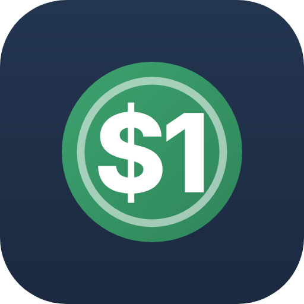

<p align="center"></p>

<h1 align="center">Once Budget</h1>

<p align="center">Envelope budgeting that's yours: works offline, no accounts, no tracking.<br>
Android app and web app, with an optional sync server you run on your own hardware.</p>

<p align="center">by <a href="https://righttoownllc.com">RightToOwn LLC</a></p>

---

## What it is

Once Budget gives every dollar a job. Money that comes in goes to **Ready to assign**; you assign
it to categories until nothing is left, then spend from those categories. Overspend one, and the
app helps you cover it from another.

- **Offline first.** The Android app works with no internet and no account. Your budget stays on
  your phone unless you choose to sync it.
- **Tap-to-pay capture.** Pay with Google Wallet and the app offers to log the purchase (store,
  amount, card), with tips the bank hasn't posted yet handled for you.
- **Your own server, if you want one.** A small Docker server syncs phones and browsers, keeps 14
  days of nightly backups and works on your home network, through a VPN or behind Cloudflare.
- **Households.** Each person gets their own budgets; share one with *Change everything*, *Add
  purchases* or *View only*.
- **Plans and reports.** Targets, scheduled bills, a payday forecast, a debt payoff planner,
  spending reports, net worth, and PDF and JSON export.

## Install the server

The server is published as a ready-made image for PCs, NAS boxes (amd64) and Raspberry Pi (arm64):

```
ghcr.io/righttoownllc/once-budget:latest
```

- **Unraid:** add the template [`budget/unraid/once-budget.xml`](budget/unraid/once-budget.xml)
  (Docker › Add Container › Template), or point Unraid at its raw URL.
- **Docker Compose:** copy [`budget/docker-compose.example.yml`](budget/docker-compose.example.yml)
  to a folder as `docker-compose.yml`, set your time zone, then `docker compose up -d`.

Full instructions, including first sign-in, pairing phones, using it away from home and adding
other people, are in **[DOCKER.md](DOCKER.md)**.

## The Android app

The Android app is coming to Google Play from RightToOwn LLC. Its source isn't part of this repository.
Without a server it's a complete offline budgeting app; with one, it syncs with your server and
the web app. You don't need it to use the server: the web app runs in any browser.

## Privacy

RightToOwn LLC collects nothing: no analytics, no crash reporting, no ads, no account. See
**[PRIVACY.md](PRIVACY.md)**.

## Repository layout

| Folder | What's in it |
|---|---|
| `budget/web` | The app's screens (Preact): the web app, also used inside the Android app |
| `budget/server` | The sync server (Node, Hono, built-in SQLite) |
| `budget/unraid` | Unraid template |
| `.github/workflows` | Builds and publishes the server image |

## Licence

The server and web app in this repository are free software, licensed under the **GNU Affero
General Public License v3.0** ([LICENSE](LICENSE)). You may use, study, share and modify it; if you offer a modified version to
others, including as a hosted server, you must make your changes available under the same licence. The Android app and the Once Budget name and icon are not covered by this licence.

© RightToOwn LLC
